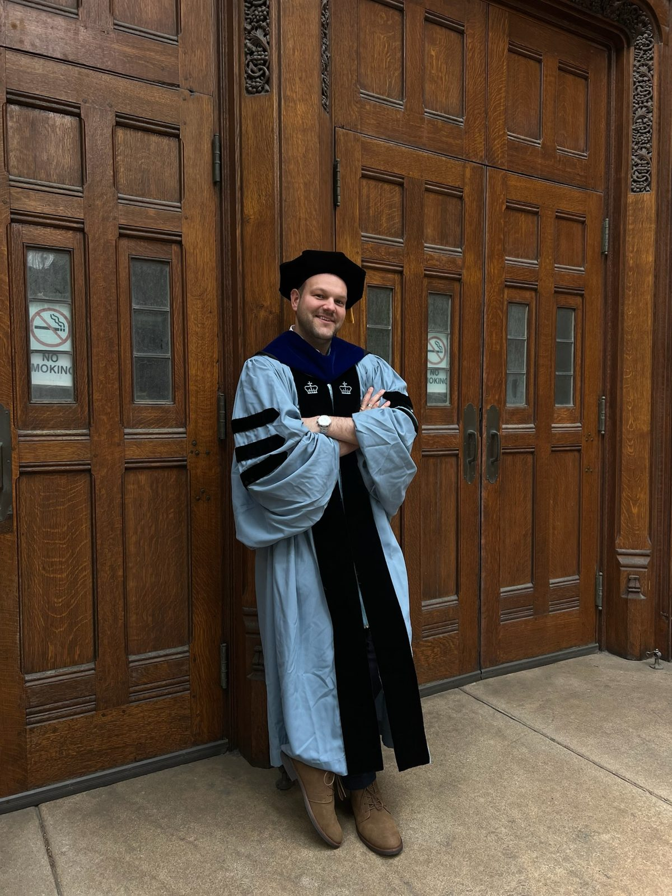
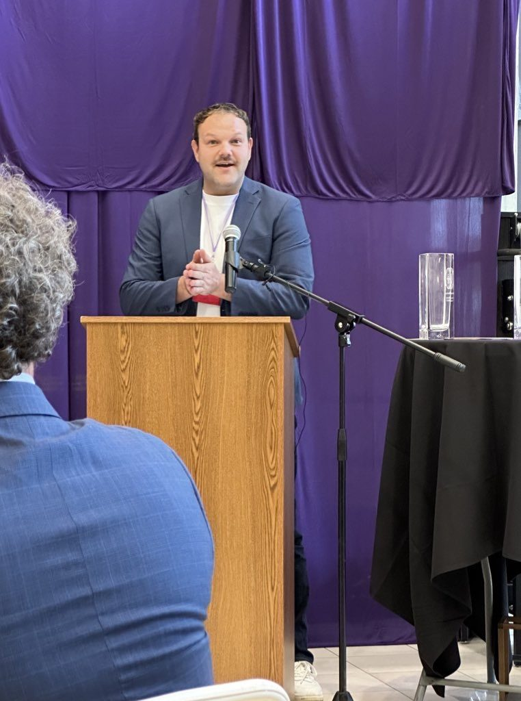
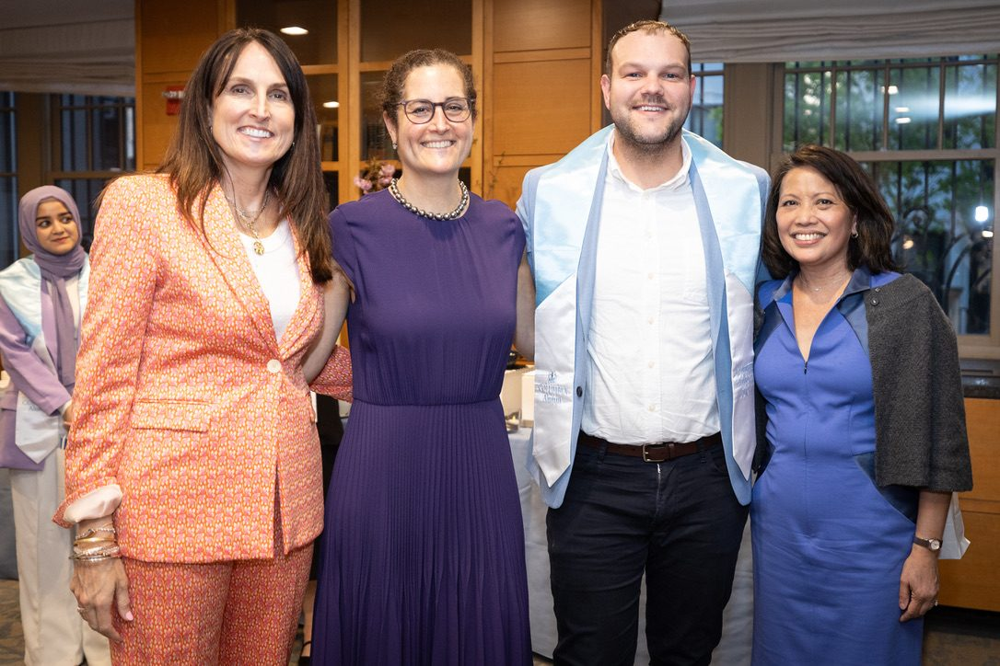
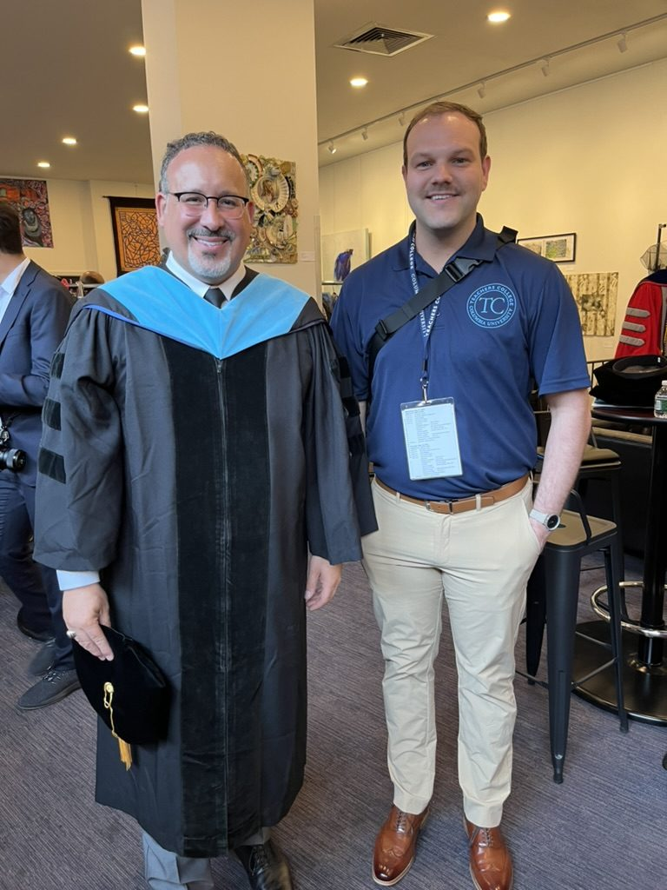
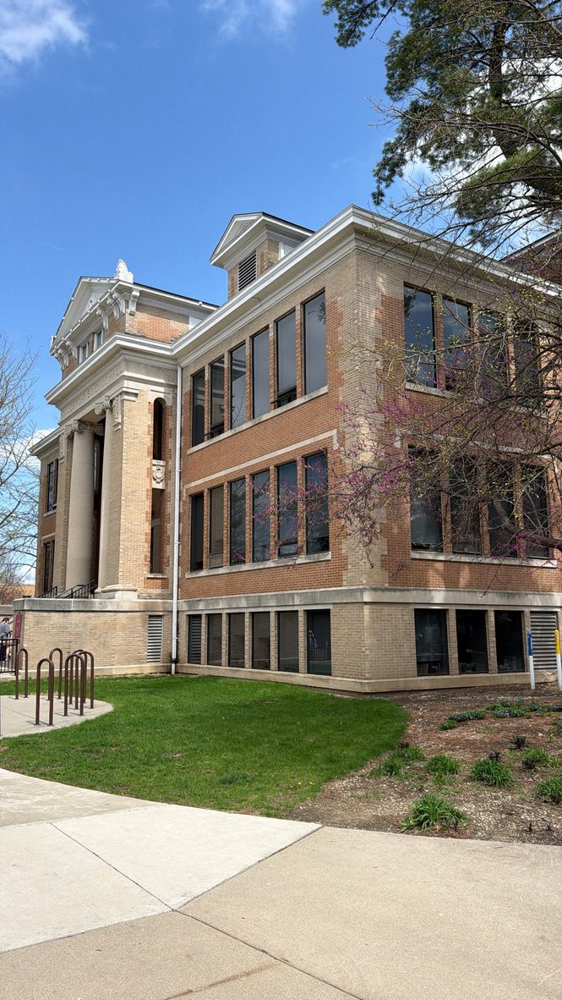
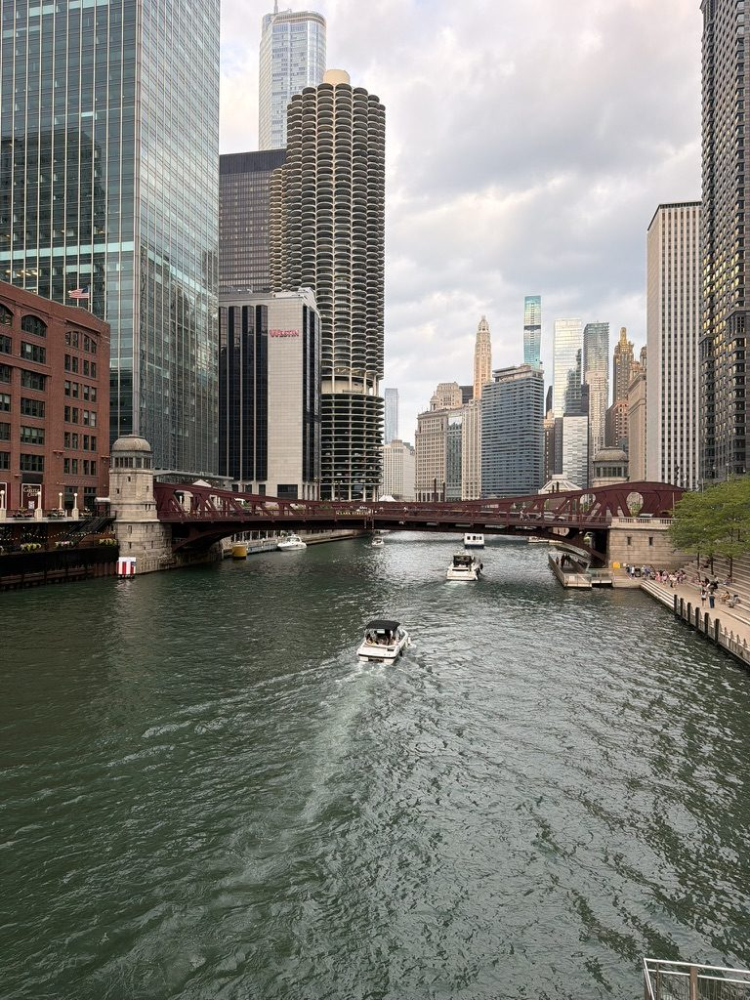
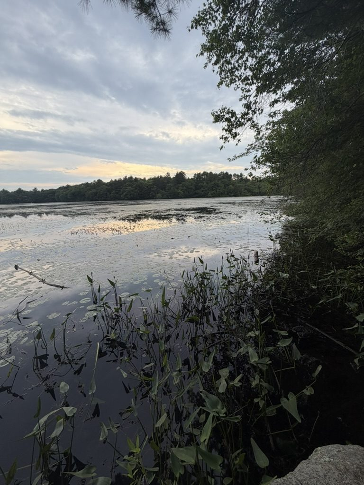

:::: {.split}

::: {.split-text}
I'm from New Plymouth, a rural town in southwestern Idaho, where the public schools were the center of the community. Most of what I study today traces back to that experience: who governs our schools, who gets a voice in those decisions, and how schools and teachers prepare us to be citizens.

I studied political economy at The College of Idaho, then earned an M.A. in political science at Duke University and a Ph.D. in Politics & Education at Columbia University. My work today views education as a political institution, not just a policy area. I have taught graduate seminars on American politics and education, federalism, and the policy process. 

After Columbia, I was a postdoctoral researcher at Brown University with the Annenberg Institute and the Realizing Rights Lab. There I ran exit polls in school board elections alongside undergraduate students, and built out work on administrative burden/ease and democratic participation.

Today, I am an Assistant Professor of Political Science at North Central College. I live in Chicago and make the commute out to Naperville, which gives me time to catch up on emails (and to listen to Taylor Swift). I still follow Idaho education policy closely, and I write about it for *Idaho Ed News* whenever I can.

Outside of work, you can usually find me watching the latest Netflix show, catching up on pop culture, or exploring a new corner of Chicago.
:::

::: {.split-photo}
{.lightbox group="about" fig-alt="Cameron Arnzen in Columbia doctoral regalia in front of large wooden doors"}
:::

::::

## Recognition

- **Emerging Education Policy Scholar**, The Thomas B. Fordham Institute and American Enterprise Institute (2026–27)
- **Campbell Award** for exceptional leadership and Columbia spirit, Columbia University Alumni Association (2024)
- **G.O.L.D. Award** (Outstanding Graduate of the Last Decade), The College of Idaho (2024)

## A few moments

::: {.photo-row .square}
{.lightbox group="about" fig-alt="Cameron Arnzen speaking at a podium after receiving an alumni award"}

{.lightbox group="about" fig-alt="Cameron Arnzen with three representatives of the Columbia Alumni Association"}

{.lightbox group="about" fig-alt="Cameron Arnzen with Secretary of Education Miguel Cardona"}

{.lightbox group="about" fig-alt="Goldspohn Hall at North Central College"}

{.lightbox group="about" fig-alt="The Chicago River and downtown skyline"}

{.lightbox group="about" fig-alt="A quiet lake in Rhode Island at dusk"}
:::
