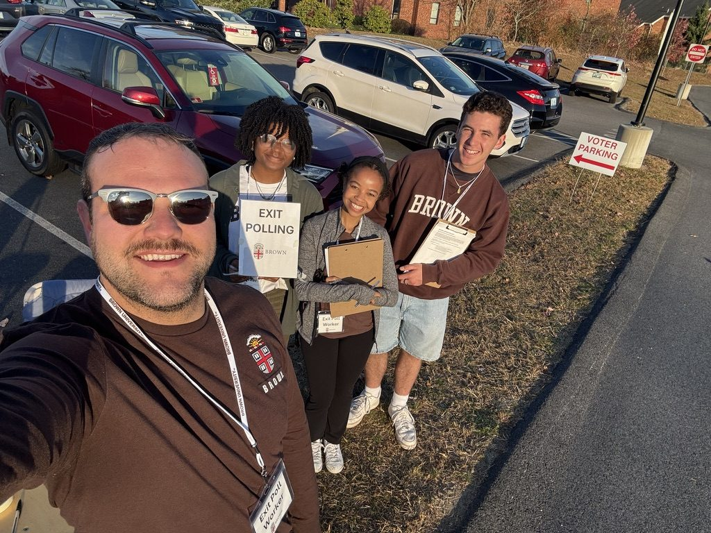
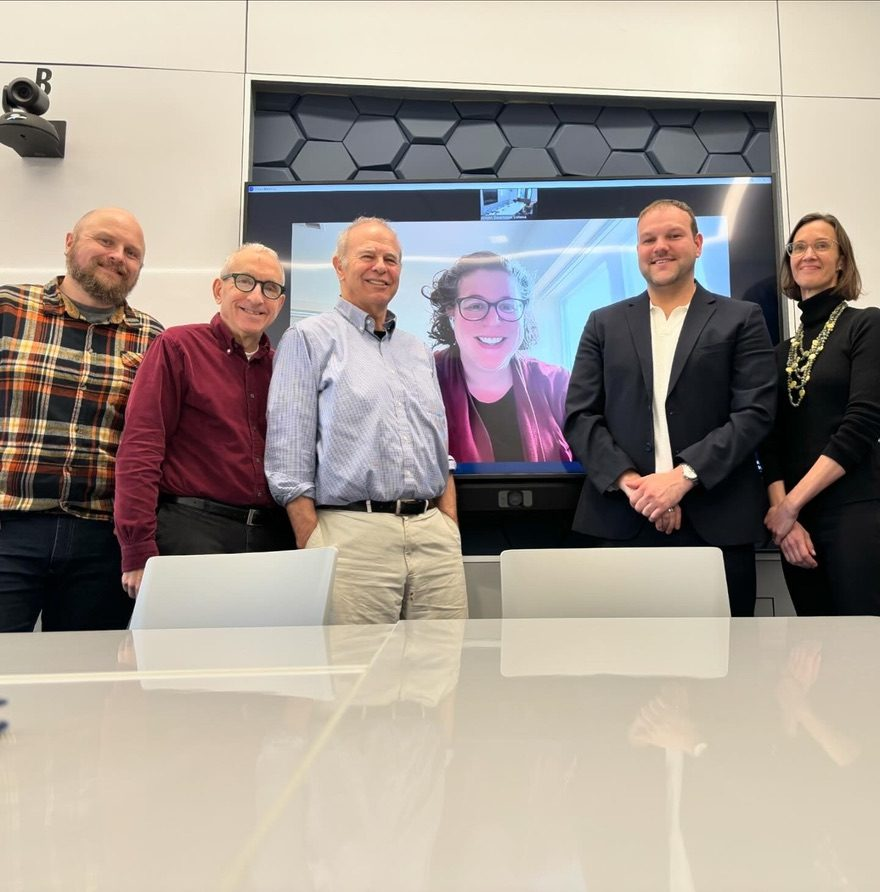
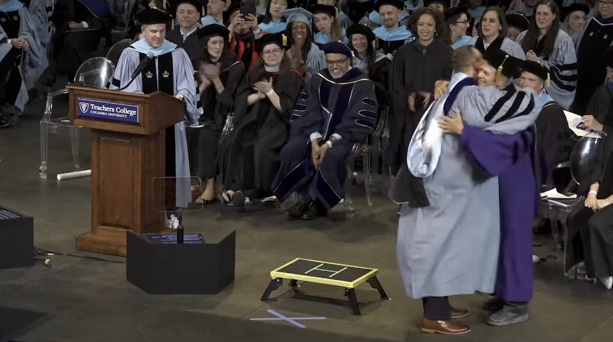
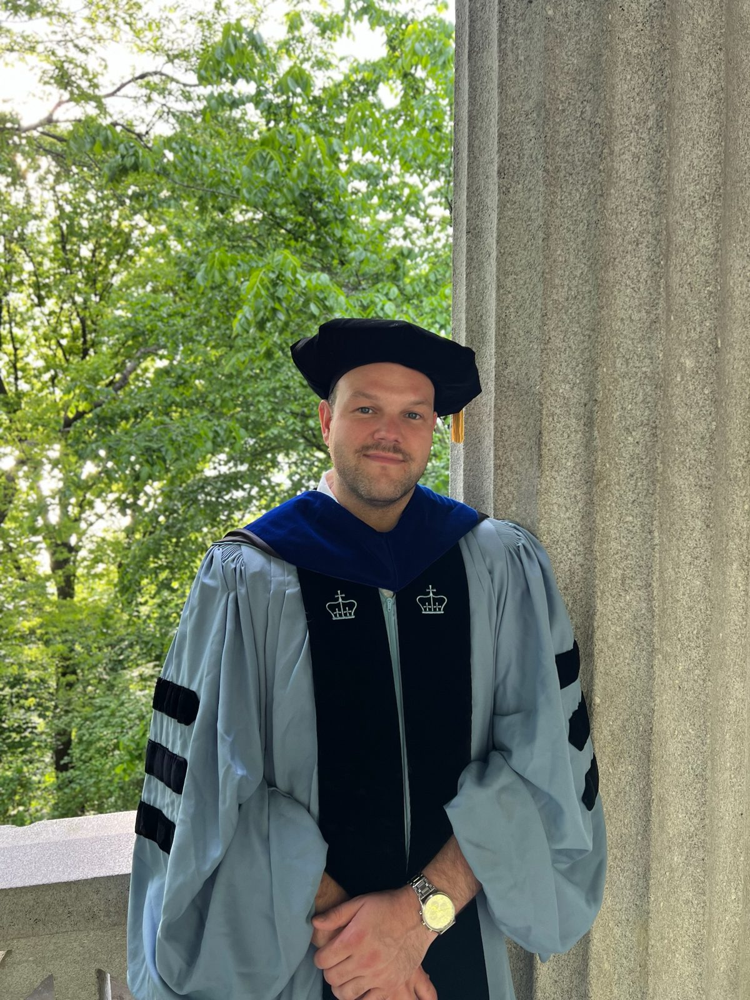

:::: {.split}

::: {.split-text}
My research examines how educational institutions shape democratic participation and how citizens shape the governance of public education. I focus on the politics of education governance, administrative ease in democratic participation, and the role of schools in producing civic engagement.

Across projects, I combine original data, such as school board election exit polls and web-scraped district information, with large administrative datasets to understand how institutional design shapes citizens' access to democratic participation.
:::

::: {.split-photo}
{.lightbox group="research" fig-alt="Cameron Arnzen with three student exit poll workers outside a polling place"}
:::

::::

## Peer-reviewed articles

::: {.pub-list}
- Arnzen, Cameron, and Rebecca Jacobsen. 2026. "Neighborhood Democracy: The Politicization of School Boards and Implications for Democratic Education." *AERA Open*. Forthcoming.
- Arnzen, Cameron, and Sarah Cohodes. 2026. "[Education and the Gender Gap in Presidential Elections](https://www.sciencedirect.com/science/article/pii/S0261379426000703)." *Electoral Studies*.
- Arnzen, Cameron. 2026. "[An Education in Devolution? The Political Consequences of the Elimination of the U.S. Department of Education](https://academic.oup.com/publius/article-abstract/56/3/690/8710125)." *Publius: The Journal of Federalism*.
- Arnzen, Cameron. 2026. "[Education and the Unequal Costs of Voting: Administrative Burdens and Democratic Participation](https://onlinelibrary.wiley.com/doi/abs/10.1111/psj.70106)." *Policy Studies Journal*.
- Nuñez, M., Cameron Arnzen, H. Rosenstein, J. Collins, and Susan Moffitt. 2026. "[Administrative Designs and Access to Political Arenas in Public Education](https://onlinelibrary.wiley.com/doi/10.1111/gove.70086)." *Governance* 39(1).
- Arnzen, Cameron, and Chloe O'Neill. 2025. "[Teaching About Schooling: Integrating Education Politics into Political Science Curricula](https://doi.org/10.1080/15512169.2025.2579228)." *Journal of Political Science Education*.
- Brezicha, Kristina, Cameron Arnzen, J. Childs, E. Germain, S. Horsford, D. A. Jenkins, and A. LoBue. 2023. "Political Polarization of Education Politics and Its Implications for Democratic Education." *Peabody Journal of Education* 98(5): 467–471.
- Arnzen, Cameron, and David Houston. 2023. "Who Should Control Education Now? Revisiting Preferences for Local Control of Educational Decision-Making." *Peabody Journal of Education* 98(5): 526–532.
:::

## Book chapters

::: {.pub-list}
- Arnzen, Cameron. "Decentralized Spending & Divergent Priorities: State-Level Determinants of Education Investment in the United States." In *Research Handbook on Federalism and Education Policy*, ed. Kenneth Wong. Forthcoming 2027.
- Almes, Josh, and Cameron Arnzen. "Political Partisanship in Decentralized Education Systems: The Case of United States School Districts." In *Research Handbook on Federalism and Education Policy*, ed. Kenneth Wong. Forthcoming 2027.
- Arnzen, Cameron, and David Houston. "Are Rural Voters Exceptional in a Polarized Education Landscape?" In *The 'Red' Schoolhouse: Conservative Education Policy in the United States*, ed. Chad Lochmiller. Forthcoming.
- Houston, David, Cameron Arnzen, M. Duff, and A. Mangla. "The Politics of Educational System Change." In *The Oxford Handbook on Transforming Systems in Education*. In preparation.
:::

## Working papers

::: {.pub-list}
- "[A National Measure of School District Partisanship for the 2016 to 2024 Presidential Elections](https://edworkingpapers.com/ai26-1600)." With Josh Almes.
- "[Are Rural Attitudes Exceptional in a Polarized Education Landscape?](https://edworkingpapers.com/ai26-1481)" With David Houston.
- "[The Influence of Partisanship in Local School Board Elections: Evidence from Exit Polls in Two States](https://edworkingpapers.com/ai25-1360)." With Rebecca Jacobsen.
- "[The Politics of Administrative Ease: Access to Special Education Information](https://edworkingpapers.com/ai26-1447)." With Lindsey Kaler, Alex Contreras, Bryan Natividad, Niamh Stull, and Susan Moffitt.
- "Governance Disrupted: The Effects of Closing the Department of Education on the Educational Ecosystem." With Lindsey Kaler, J. Fallon, Niamh Stull, and Susan Moffitt.
- "How Education Drives LGBTQ+ Political Participation."
- "Defining Citizenship: A Participatory-Content Typology of U.S. State-Level Civic Education Policies." With Chloe O'Neill.
:::

## Ongoing projects

- K–12 school district partisanship [(with Josh Almes)]{.muted}
- The politics of administrative ease [(with [Susan Moffitt](https://polisci.brown.edu/people/susan-moffitt) and [Lindsey Kaler](https://www.lindsey-kaler.com/))]{.muted}
- Effects of the dissolution of the Department of Education [(with Lindsey Kaler, [Niamh Stull](https://polisci.brown.edu/people/niamh-stull), and Susan Moffitt)]{.muted}
- d/Deaf political attitudes and participation
- The effects of colleges on voting [(with [Isabel McMullen](https://www.isabelmcmullen.com/))]{.muted}
- Local endorsements in school board elections [(with [Ariell Bertrand](https://scholar.google.com/citations?user=1mmSjB4AAAAJ&hl=en) and [Rebecca Jacobsen](https://education.msu.edu/people/j/jacobsen-rebecca))]{.muted}
- Contentious school board politics and the democratic education of youth [(with Rebecca Jacobsen)]{.muted}
- Defining citizenship: a typology of state civic education policy [(with Chloe O'Neill)]{.muted}

## Dissertation

*Education for Democracy: Essays Interrogating the Relationship Between Education and Voting.* Ph.D. in Politics & Education, Columbia University, 2024.

::: {.photo-row}
{.lightbox group="dissertation" fig-alt="Cameron Arnzen with his dissertation committee"}

{.lightbox .pos-right group="dissertation" fig-alt="Jeffrey Henig hugging Cameron Arnzen on stage at commencement"}

{.lightbox group="dissertation" fig-alt="Cameron Arnzen in Columbia doctoral regalia"}
:::
