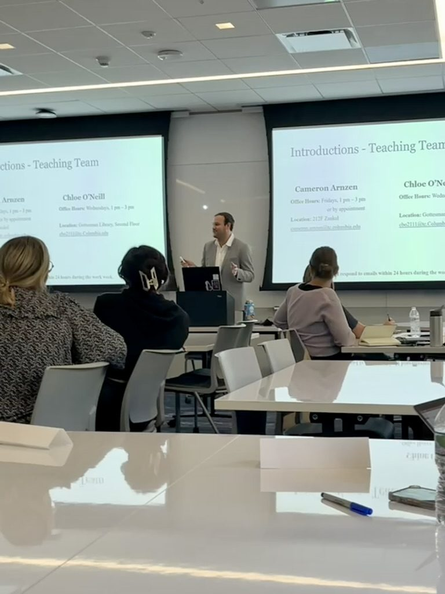
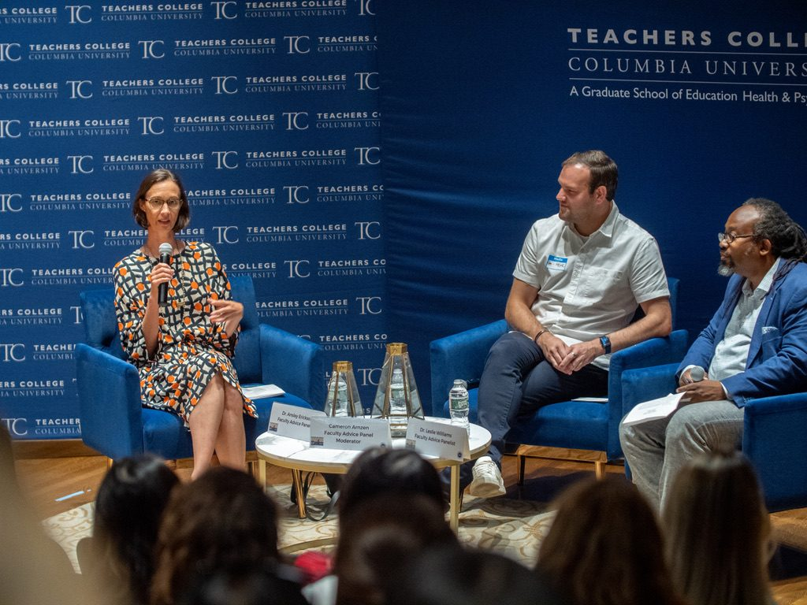

I work hard to ensure that all of my classes are simultaneously challenging and inviting spaces that encourage curiosity and  critical thinking. My goal for every student is for them to leave my classes as more informed and more engaged citizens than when they started. 

> "Education is the universal solvent, and the relationship is always in the same direction. The higher the education, the greater the 'good' values of the variable."
> — Philip E. Converse & Angus Campbell, 1972

::: {.photo-row}
{.lightbox group="teaching" fig-alt="Cameron Arnzen at the front of a classroom with slides introducing the teaching team"}

{.lightbox group="teaching" fig-alt="Cameron Arnzen moderating a faculty panel on stage"}
:::

::: {.institution}
## North Central College
[Assistant Professor · 2026–]{.role}
:::

:::: {.courses}
::: {.course}
### Introduction to American Politics
The ideas, actors, and institutions of the American political system, with a community-engaged learning component that puts course concepts into practice.
:::
::: {.course}
### Public Opinion & Political Behavior
How opinion is measured and where it comes from, whether it shapes policy, and the study of voting, participation, partisanship, and polarization.
:::
::: {.course}
### Politics of Public Policy
Policy as the product of politics, followed from agenda setting through implementation and feedback, with cases on voting, health, education, and housing.
:::
::::

::: {.institution}
## Teachers College, Columbia University
[Adjunct Assistant Professor of Politics & Education · 2022–2024]{.role}
:::

:::: {.courses}
::: {.course}
### American Politics & Education
[Graduate seminar]{.kind}

The political forces behind educational decisions: governance, funding, desegregation, and civic education.
:::
::: {.course}
### Politics of Centralization & Decentralization
[Graduate seminar]{.kind}

How authority is allocated across nation, state, and locality, and what it means for responsiveness in education.
:::
::: {.course}
### Politics & Public Policy
[Graduate seminar]{.kind}

Policy origins, from agenda setting to adoption, through cases in early childhood, K–12, and higher education.
:::
::: {.course}
### Politics & Education Thesis Capstone
[Graduate capstone]{.kind}

Supporting master's students as they design and complete their thesis projects in politics and education.
:::
::::

::: {.institution}
## The College of Idaho
[Adjunct Professor · Caldwell, Idaho]{.role}
:::

:::: {.courses}
::: {.course}
### Politics of Education
[Undergraduate lecture]{.kind}

K–12 governance, funding, and politicization in the U.S., compared with other countries' systems.
:::
::: {.course}
### Political Ideologies & Arguments
[First-year seminar]{.kind}

Ideologies as lenses on politics, philosophy, and economics, and what a left–right spectrum leaves out.
:::
::: {.course}
### Data Analysis for Public Policy
[Undergraduate course]{.kind}

Using data to define policy problems and evaluate the options for addressing them.
:::
::: {.course}
### Internship Practicum
[Undergraduate Practicum]{.kind}

Supporting students through their internship placements and helping them build professional portfolios.
:::
::::

## Other teaching

**Brown University** (Instructor): Introduction to Statistics & Programming, Undergraduate Research Fellows for Social Science and Public Policy (Summer 2025)

**Columbia University** (Teaching Assistant): Political Behavior (Barnard) · Reforming American Elections · Empirical Methods in Political Science (Barnard) · Introduction to American Politics · Politics of Centralization & Decentralization · Data Analysis for Policy & Decision Making II · Politics & Public Policy

[Student evaluations (password protected) →](https://forms.gle/3gSmHrcaf6vJYZE99)
